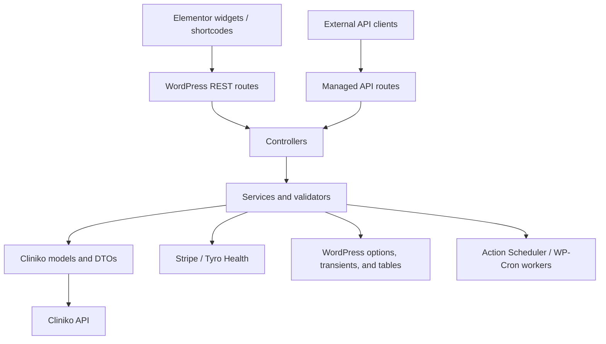

# Plugin Architecture Guide

This document is a maintainer map for the WordPress Cliniko Stripe Plugin. It describes the current code organization, the direction requests typically take through it, and where to start when making common changes. It is not a substitute for the endpoint-specific guides or for tracing a particular feature before editing it.

## At a glance

The plugin is a WordPress-hook-based application organized into layers. WordPress owns the runtime and persistence primitives; the plugin provides the booking, patient, Cliniko, payment, and administration behavior.

The code is layered, but not every older feature follows a strict controller-service-model separation. Some controllers contain substantial orchestration, and some route and admin classes construct their collaborators directly. For a focused change, follow the closest existing feature path rather than assuming every feature has identical boundaries.

## Startup and composition

The root file, [`wordpress-cliniko-stripe-plugin.php`](../wordpress-cliniko-stripe-plugin.php), is the WordPress entry point. It loads the bundled Action Scheduler, Composer autoloader, and helper functions; registers Elementor widgets; calls `App\Bootstrap::init()`; and adds the Tyro-related CSP domains.

[`src/Bootstrap.php`](../src/Bootstrap.php) initializes shared support and routes, then checks the Ultimate Member dependency. If Ultimate Member is inactive, Bootstrap returns before initializing the main patient, route, and admin modules. Elementor widget registration is wired in the root file separately.

The main startup responsibilities are:

- [`src/Routes/ApiRoutes.php`](../src/Routes/ApiRoutes.php) assembles the website-facing guest, patient-link, authenticated-patient, and authenticated-booking routes.
- [`src/Routes/ManagedApiRoutes.php`](../src/Routes/ManagedApiRoutes.php) conditionally registers the configurable external API.
- [`src/Admin/PluginFacade.php`](../src/Admin/PluginFacade.php) initializes the admin modules, shortcodes, account builders, settings, and background workers.
- [`src/Widgets/Widgets.php`](../src/Widgets/Widgets.php) registers the Elementor appointment card, price tag, and booking form widgets.

## Layers and responsibilities

| Area | Main location | Responsibility |
| --- | --- | --- |
| WordPress entry point | `wordpress-cliniko-stripe-plugin.php` | Load dependencies and helpers; register top-level WordPress and Elementor hooks. |
| Bootstrap | `src/Bootstrap.php` | Wire the application into WordPress and apply the Ultimate Member dependency gate. |
| Presentation | `src/Widgets/`, `src/Admin/Modules/`, widget `assets/` and `templates/` | Render Elementor widgets, admin configuration screens, and patient-facing shortcodes. Front-end JS handles interactions and sends requests to the server. |
| Routes | `src/Routes/` | Declare REST paths, HTTP methods, callbacks, and route-level permission callbacks. |
| Controllers | `src/Controller/` | Adapt WordPress requests and responses and invoke the relevant application behavior. Controllers vary in how much orchestration they contain. |
| Services | `src/Service/` | Implement booking, patient, payment, verification, form, and API business rules. This is usually the best place for reusable domain behavior. |
| Validation | `src/Validator/` and service-level validators | Validate request and form data before it changes Cliniko or plugin state. |
| Authorization | `src/Authorization/`, `src/Support/PatientSessionGuard.php`, `src/Service/PublicRequestGuard.php` | Apply patient verification, session, route-policy, and public-mutation checks. |
| Cliniko client | `src/Client/Cliniko/`, `src/Contracts/` | Send authenticated HTTP requests to Cliniko behind the plugin's API client interface. |
| Cliniko models | `src/Model/`, `src/Core/Framework/AbstractModel.php` | Represent Cliniko resources and provide resource operations over the API client. |
| Data transfer objects | `src/DTO/` | Map Cliniko request/response structures into typed PHP objects and arrays. |
| Background processing | `src/Infra/JobDispatcher.php`, `src/Workers/`, webhook worker classes | Queue work through Action Scheduler and fall back to WP-Cron when needed. |
| Local state | WordPress options/transients and selected custom tables | Store plugin settings, booking-attempt records, cache data, and job ledgers. Check the feature's store before changing persistence. |

## The REST API surfaces

There are multiple API surfaces. Identify which one a client uses before changing a route or contract.

### Website booking and patient routes

[`src/Routes/PublicGuestRoutes.php`](../src/Routes/PublicGuestRoutes.php) registers public website endpoints, including availability and form-template reads, payment actions, patient-access flows, and the `v2` booking-attempt lifecycle. [`src/Routes/AuthenticatedPatientRoutes.php`](../src/Routes/AuthenticatedPatientRoutes.php) registers patient `/v2/patient/me/...` operations and attaches a verified-patient policy. [`src/Routes/AuthenticatedBookingRoutes.php`](../src/Routes/AuthenticatedBookingRoutes.php) handles patient-account booking routes.

[`src/Routes/ApiRoutes.php`](../src/Routes/ApiRoutes.php) composes these route groups. A route's `permission_callback` is part of its behavior; do not treat it as boilerplate when editing a route.

### Configurable managed API

The managed API is a separate surface for external clients. [`ManagedApiRoutes.php`](../src/Routes/ManagedApiRoutes.php) registers active endpoint definitions in configured namespaces. Its endpoint catalog and settings determine which endpoints are published. [`src/Authorization/Api/AccessPolicy.php`](../src/Authorization/Api/AccessPolicy.php) applies access rules, and [`src/Controller/Api/ManagedController.php`](../src/Controller/Api/ManagedController.php) dispatches endpoint operations and normalizes responses, errors, audit metadata, and request handling.

When changing this API, trace the endpoint definition, publication settings, access policy, dispatch branch, and corresponding API documentation together. Do not assume that changing a website `/v1` or `/v2` route also changes the managed API contract.

## Main booking flows

### Current booking-attempt flow

The Elementor booking form's front-end code calls the `v2` booking-attempt endpoints. In outline:

1. The route invokes [`BookingAttemptController`](../src/Controller/BookingAttemptController.php), which delegates booking operations to [`BookingAttemptService`](../src/Service/BookingAttemptService.php).
2. Preflight sanitizes and validates the submitted patient/form data, checks the appointment type and template with Cliniko, validates practitioner and slot selection, and resolves the patient. It creates a draft patient form and stores a booking-attempt record through [`BookingAttemptStore`](../src/Service/BookingAttemptStore.php).
3. The browser completes payment through Stripe or Tyro Health. The server verifies the payment and records its result on the attempt.
4. Finalization creates the Cliniko appointment, links the patient form, updates attempt state, and emits configured booking webhooks.

Booking attempts are currently stored as individual, non-autoloaded WordPress options. Attempt access uses an attempt token whose hash is stored with the record. The preflight flow also queues cleanup for unfinished attempts.

### Older queued paths

Some earlier website payment and form paths use [`SchedulingDispatchService`](../src/Service/SchedulingDispatchService.php) and [`JobDispatcher`](../src/Infra/JobDispatcher.php) to queue work. The scheduling job is handled by [`ClinikoSchedulingWorker`](../src/Workers/ClinikoSchedulingWorker.php); patient-form creation has its own worker. These paths coexist with the newer booking-attempt service, which performs its final appointment creation in its own flow. Before changing a worker, confirm the calling route/controller still uses it.

## Cliniko and payment integrations

The shared Cliniko [`Client`](../src/Client/Cliniko/Client.php) uses WordPress HTTP functions and implements the plugin API-client contract. Models such as `Patient`, `AppointmentType`, and `IndividualAppointment` use that client, commonly through the shared [`AbstractModel`](../src/Core/Framework/AbstractModel.php) resource operations. DTOs handle payload mapping. [`ClinikoService`](../src/Service/ClinikoService.php) contains higher-level Cliniko operations used across features.

Stripe and Tyro-specific behavior lives in payment services and controllers, including [`StripeService`](../src/Service/StripeService.php) and [`TyroHealthService`](../src/Service/TyroHealthService.php). Booking logic coordinates the gateway with the Cliniko workflow. Keep secrets and server-side verification in PHP; browser code should only handle the provider SDK flow and pass the appropriate provider token/reference back to the server.

## Patient accounts and authorization

Ultimate Member supplies WordPress patient accounts and roles. The plugin links those accounts to Cliniko patients and provides verification, patient profile, appointment, attachment, and communication operations. REST authorization is implemented through route policies and guards; authenticated operations should resolve the patient from the verified server-side account/session rather than trusting a patient ID supplied by the browser.

Before changing patient identity or access behavior, trace the route policy and the related service together. Relevant areas include `src/Authorization/`, `src/Support/`, and the patient-related services and controllers.

## Admin, widgets, and shortcodes

Admin functionality is split into modules under `src/Admin/Modules/`. [`PluginFacade`](../src/Admin/PluginFacade.php) is the composition point that initializes them. Settings modules configure credentials and integrations; account-builder modules configure portal forms, dashboard modules, email templates, and shortcodes.

The Elementor form widget is in `src/Widgets/ClinikoForm/`. Its PHP class registers controls and rendering; templates provide markup; JavaScript handles the interactive wizard, calendar, and payment handoff. When behavior crosses the browser/server boundary, update both sides and keep server validation authoritative.

## Background jobs and webhooks

[`JobDispatcher`](../src/Infra/JobDispatcher.php) is the common queue adapter. It prefers Action Scheduler and falls back to WP-Cron. Worker hooks are registered during plugin initialization. Webhook dispatch and delivery use the classes under `src/Widgets/ClinikoForm/Webhooks/`, with a dedicated delivery worker.

For a new job, define a stable action name and payload shape, register a worker for that hook, and locate the dispatch call. Make the handler safe to retry if repeating the operation could duplicate a booking, payment action, or outbound event. Existing booking and webhook code uses idempotency, locks, ledgers, or attempt state in different places; follow the specific flow's existing protection.

## Where to start for common changes

| Change | Start by inspecting |
| --- | --- |
| Change booking form layout or browser interaction | `src/Widgets/ClinikoForm/templates/` and `src/Widgets/ClinikoForm/assets/` |
| Change a website REST endpoint | Its route class in `src/Routes/`, callback controller in `src/Controller/`, then the service and permission policy it uses |
| Change booking validation or lifecycle | `src/Service/BookingAttemptService.php`, its controller, validators, and `BookingAttemptStore.php` |
| Change patient portal behavior | Relevant `AuthenticatedPatientRoutes.php` route, controller, authorization policy, and patient service |
| Change Cliniko request/response mapping | Relevant `src/Model/` class and `src/DTO/` class, then the client/service call site |
| Change Stripe or Tyro behavior | `src/Service/StripeService.php` or `TyroHealthService.php`, plus the booking/payment controller and front-end SDK code if applicable |
| Add or change a managed API endpoint | `src/Service/Api/EndpointCatalog.php`, `ApiSettings.php`, `src/Authorization/Api/AccessPolicy.php`, `ManagedController.php`, and API docs |
| Change WordPress admin configuration | Relevant `src/Admin/Modules/` module and its initialization in `PluginFacade.php` |
| Change an Elementor widget | Its widget class and controls/templates/assets under `src/Widgets/`, plus `src/Widgets/Widgets.php` if it is a new widget |
| Add asynchronous work | `src/Infra/JobDispatcher.php`, the dispatch site, worker class, and worker registration in `PluginFacade.php` |
| Change plugin-local persistence | The feature's store/service and every reader/writer; check whether state lives in options, transients, user metadata, or a custom table |

## Practical change checklist

1. Find the user-facing entry point: widget, shortcode, admin screen, or API route.
2. Trace the request to its controller, service, authorization policy, and external integration or store.
3. Identify whether the feature uses the newer booking-attempt flow, an older queued path, or the managed API.
4. Preserve route permission checks, server-side validation, secret handling, and idempotency/retry behavior relevant to that path.
5. Update the matching tests under `tests/` and any endpoint or setup documentation when the contract changes.
6. Search for other callers of a changed service, worker hook, option key, or DTO field before changing its shape.

## Tests and related documentation

The `tests/` directory includes focused coverage such as `booking_attempt_flow_test.php`, `authenticated_patient_routes_test.php`, `managed_api_test.php`, `payment_endpoints_test.php`, and `worker_flow_test.php`. API contract and setup guides live in `docs/`; the README describes installation and operator-facing features.
